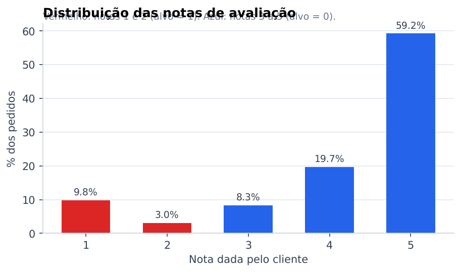
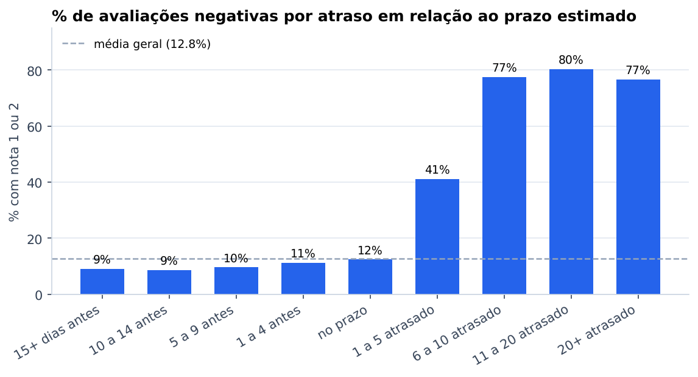
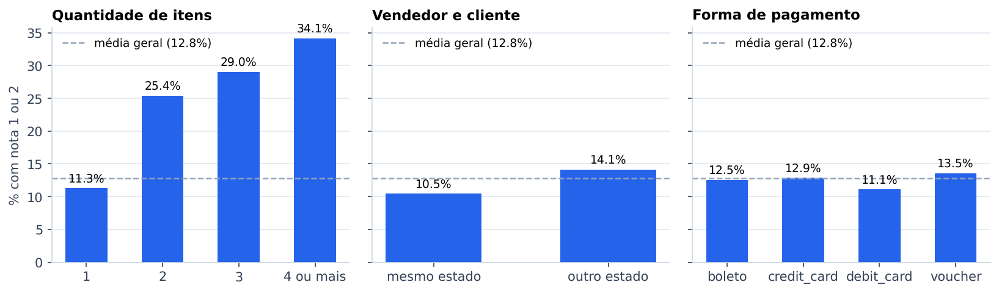
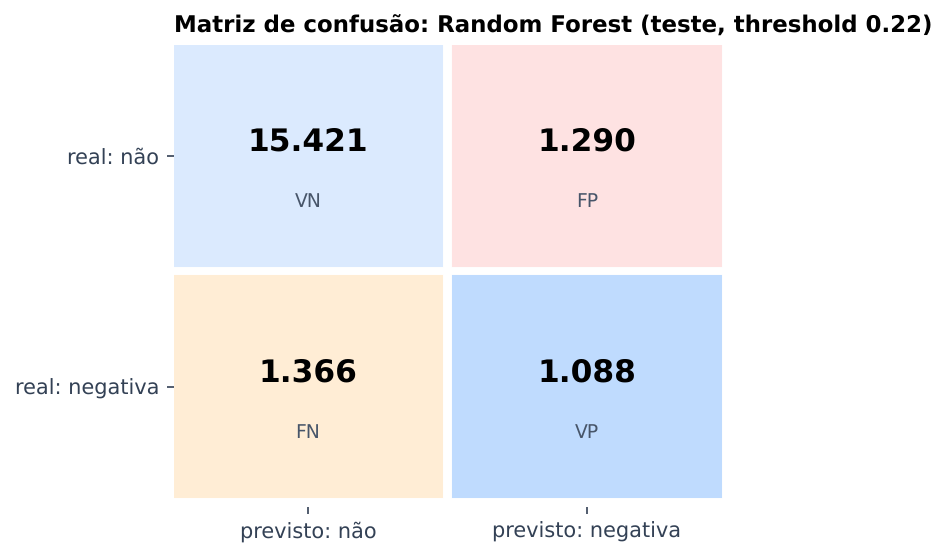
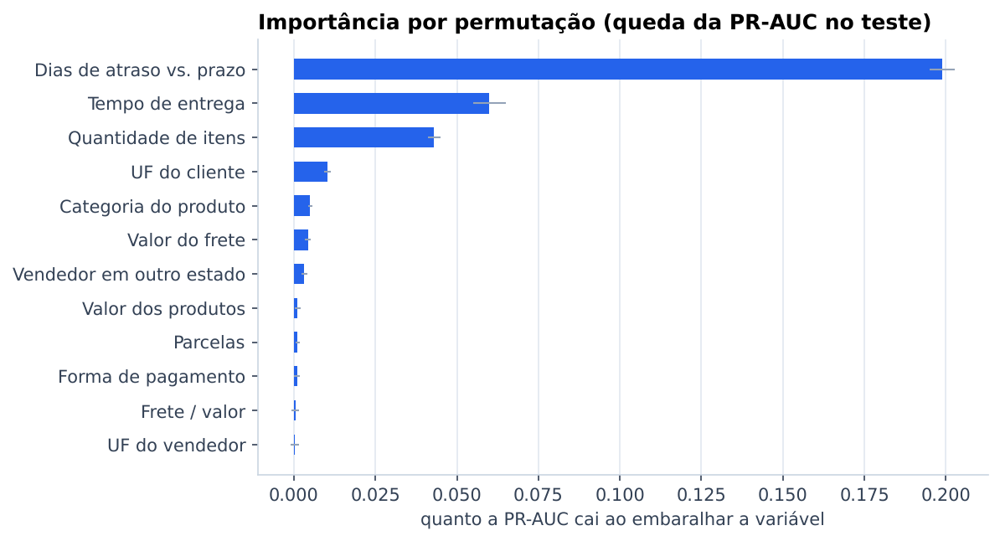

# Risco de avaliação negativa em pedidos de e-commerce (Olist)

Projeto final de Aprendizagem de Máquina (Engenharia de Software, Católica SC), Equipe 4: Eduarda, Eduardo e Anna.

Criamos um modelo de classificação que estima a chance de um pedido já entregue receber nota 1 ou 2 do cliente. Com essa estimativa, o time de atendimento sabe quais pedidos olhar primeiro e pode entrar em contato antes de o cliente avaliar. O modelo foi treinado com dados públicos de cerca de 100 mil pedidos do marketplace Olist.

<!-- Responsável: Eduarda -->
## Página de teste

https://risco-avaliacao-olist.streamlit.app/

Informe os dados de um pedido (ou use um dos exemplos prontos) e veja a probabilidade de avaliação negativa, a faixa de risco, a ação sugerida para o atendimento e os fatores que mais pesaram.

## Problema e público-alvo

Hoje o marketplace só descobre que o cliente ficou insatisfeito quando a nota 1 ou 2 já foi dada, e aí é tarde para reverter. Queremos prever esse risco **antes** da avaliação. O público-alvo é o time de atendimento (CX): depois da entrega, ou assim que o prazo estimado vence, o modelo devolve uma probabilidade, uma faixa de risco e uma ação sugerida, para a equipe decidir com quem falar primeiro.

## Dataset

*Brazilian E-Commerce Public Dataset by Olist*, disponível no [Kaggle](https://www.kaggle.com/datasets/olistbr/brazilian-ecommerce). São cerca de 100 mil pedidos reais e anonimizados, feitos de 2016 a 2018, em 9 tabelas. Usamos 8 delas (pedidos, itens, pagamentos, avaliações, clientes, vendedores, produtos e tradução de categorias) e deixamos de fora a de geolocalização, porque a UF do cliente e do vendedor já vem nas outras tabelas.

Juntamos tudo em **uma linha por pedido** e ficamos com **95.823 pedidos** entregues e avaliados (10/2016 a 08/2018). O alvo é `negativa = 1` quando a nota é 1 ou 2, e `0` quando é 3, 4 ou 5.

| Tratamento | Motivo |
|---|---|
| Só pedidos entregues | O atendimento age depois da entrega; pedido cancelado é outro problema. |
| Sem pedidos sem avaliação | Sem nota não há o que aprender. |
| Pedido com vários itens: soma de valor e frete | O cliente avalia o pedido inteiro. |
| Categoria vazia vira "sem categoria" | Assim esses pedidos não são perdidos. |
| Texto e datas da avaliação fora do modelo | Só existem depois que o cliente avaliou (vazamento de alvo). |

**Variáveis usadas:** dias de atraso em relação ao prazo, tempo de entrega, valor dos produtos, frete, frete dividido pelo valor, quantidade de itens, categoria, UF do cliente, UF do vendedor, se são estados diferentes, forma de pagamento e parcelas.

## Análise exploratória



A maioria dos clientes está satisfeita (59,2% deram nota 5), e só **12,8%** deram nota 1 ou 2. Como as classes são desbalanceadas, a acurácia engana: quem sempre diz "não vai ser negativa" acerta 87% e não encontra ninguém.



O atraso é o sinal mais forte: pedidos no prazo ou adiantados têm de 9% a 12% de notas negativas, que sobem para 41% com 1 a 5 dias de atraso e passam de 75% a partir de 6 dias. Esse "degrau" no prazo favorece um modelo de árvores.



Pedidos com mais itens recebem mais notas negativas (11,3% com 1 item e 34,1% com 4 ou mais), vendedor em outro estado também pesa um pouco (14,1% contra 10,5%), e a forma de pagamento quase não muda a taxa.

## Modelagem e resultados

- **Divisão:** 80% treino e 20% teste (estratificada), com validação cruzada de 5 partes no treino.
- **Baseline:** Regressão Logística. **Modelo final:** Random Forest (200 árvores, `min_samples_leaf=100`).
- **Threshold:** 0,22, o ponto de maior F1 na validação cruzada do treino (o padrão de 0,50 quase não geraria alertas). Com ele, o modelo alerta cerca de 12% dos pedidos.

| Métrica (teste) | Random Forest | Regressão Logística | "Sempre não" |
|---|---|---|---|
| Recall | 0,44 | 0,40 | 0,00 |
| Precisão | 0,46 | 0,43 | 0,00 |
| F1 | 0,45 | 0,42 | 0,00 |
| PR-AUC | 0,46 | 0,40 | 0,13 |
| ROC-AUC | 0,76 | 0,74 | 0,50 |
| Acurácia | 0,86 | 0,85 | 0,87 |



Dos 2.454 clientes insatisfeitos do teste, o modelo encontrou 1.088 e deixou passar 1.366; gerou 1.290 alertas à toa entre 16.711 pedidos sem nota negativa.



Na importância por permutação, embaralhar o atraso derruba a PR-AUC em cerca de 0,20. Depois vêm tempo de entrega e quantidade de itens; pagamento e parcelas quase não influenciam.

<!-- Responsável: Eduarda -->
## Como executar localmente

Requisitos: Python 3.11 ou superior.

```bash
git clone [LINK DO REPOSITÓRIO]
cd olist-avaliacao-negativa
pip install -r requirements.txt
```

Rodar o app (não precisa dos dados, usa o modelo salvo em `models/`):

```bash
streamlit run app/app.py
```

Previsão pela linha de comando (alternativa ao app):

```bash
python -m src.prever --atraso 15 --valor 180 --frete 45 --itens 1 --categoria moveis_decoracao --pagamento boleto --uf-vendedor SP --uf-cliente BA
```

Para refazer a análise e o treino: baixe os CSVs conforme [`data/LEIA-ME.md`](data/LEIA-ME.md), instale o Jupyter (`pip install jupyter`) e rode, em ordem, `notebooks/01_preparacao_eda.ipynb` e `notebooks/02_modelagem_avaliacao.ipynb`. O notebook 02 gera `models/modelo.joblib` e `models/metricas.json`.

| Pasta | Conteúdo |
|---|---|
| `notebooks/` | Preparação e EDA (01), modelagem e avaliação (02) |
| `src/` | Junção dos dados e cálculo das variáveis, usados igualmente nos notebooks, no app e no script |
| `app/` | App Streamlit |
| `models/` | Modelo treinado e métricas |
| `img/` | Gráficos usados neste README |
| `docs/`, `apresentacao/` | Guia da equipe e roteiro da apresentação |

<!-- Responsável: Eduarda -->
## Limitações

- Problemas de produto (defeito, item errado ou faltando) não aparecem nos dados. Por isso, quase todos os clientes insatisfeitos que o modelo deixa passar receberam o pedido no prazo.
- Boa parte do acerto vem de pedidos atrasados em que o cliente avaliou antes de receber (29% das notas negativas). Quando esse grupo fica de fora, a PR-AUC cai de 0,46 para 0,19. O alerta é mais útil assim que o prazo estimado vence.
- Os dados são de 2016 a 2018. Numa divisão temporal (treino com os pedidos mais antigos, teste com os mais recentes), a ROC-AUC cai de 0,76 para 0,68, porque o período recente tem menos atrasos. Em uso real, o modelo precisaria ser retreinado.
- O app estima duas variáveis que não estão no formulário: o tempo de entrega (prazo mediano da UF + atraso) e as parcelas (mediana da forma de pagamento).

## Considerações finais

O modelo resolve o problema de priorização: em vez de olhar todos os pedidos, o atendimento recebe uma lista com cerca de 12% deles, onde quase metade dos alertas é de clientes que de fato ficariam insatisfeitos, contra 12,8% se escolhesse ao acaso. Ele não resolve as insatisfações causadas pelo próprio produto (defeito, item errado ou faltando), porque essa informação só aparece no comentário da avaliação, e depende muito do atraso, então funciona melhor assim que o prazo estimado vence. Como próximos passos, usaríamos dados que existem antes da avaliação e não estão no dataset (histórico de reclamações do vendedor, rastreio da entrega, chamados abertos pelo cliente) e retreinaríamos o modelo com pedidos mais recentes que os de 2016 a 2018.

## Referências

HUNTER, J. D. Matplotlib: a 2D graphics environment. **Computing in Science & Engineering**, v. 9, n. 3, p. 90-95, 2007. DOI: 10.1109/MCSE.2007.55.

OLIST; SIONEK, A. **Brazilian E-Commerce Public Dataset by Olist**. [*S. l.*]: Kaggle, 2018. DOI: 10.34740/KAGGLE/DSV/195341. Disponível em: https://www.kaggle.com/datasets/olistbr/brazilian-ecommerce. Acesso em: 24 nov. 2026.

PANDAS DEVELOPMENT TEAM. **pandas**: documentation. Versão 2.3.3. [*S. l.*], 2025. Disponível em: https://pandas.pydata.org/docs/. Acesso em: 25 nov. 2026.

PEDREGOSA, F. *et al*. Scikit-learn: machine learning in Python. **Journal of Machine Learning Research**, v. 12, p. 2825-2830, 2011.

STREAMLIT. **Streamlit documentation**. Versão 1.50.0. [*S. l.*], 2025. Disponível em: https://docs.streamlit.io/. Acesso em: 25 nov. 2026.


